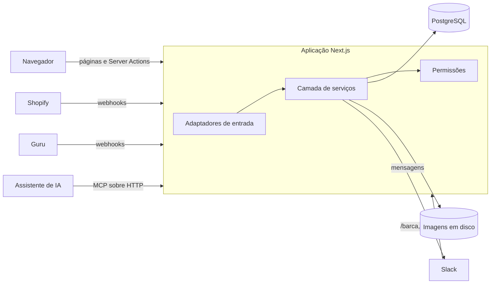

# Arquitetura

O BARCA PM é uma única aplicação Next.js com um banco PostgreSQL. As razões de cada escolha estão em [DECISIONS.md](DECISIONS.md); este documento descreve como as peças se encaixam.

## Visão geral



Há cinco portas de entrada e uma única camada de serviços. Nenhuma porta fala com o banco diretamente.

| Entrada | Onde fica | Como identifica quem está agindo |
| --- | --- | --- |
| Interface web | `src/app/(app)`, `src/app/actions` | Cookie de sessão |
| Slack | `src/app/api/slack/*`, `src/server/integrations/slack` | Assinatura do Slack + conta com o mesmo e-mail |
| Shopify | `src/app/api/webhooks/shopify` | HMAC do corpo; age como "sistema" |
| Guru | `src/app/api/webhooks/guru` | `api_token` no corpo; age como "sistema" |
| MCP | `src/app/api/mcp`, `src/server/mcp` | Token pessoal no cabeçalho `Authorization` |

## Organização do código

```
src/
  app/
    (app)/            páginas autenticadas: painel, projetos, times, pessoas, integrações…
    actions/          Server Actions (finas: chamam um serviço e atualizam a tela)
    api/              rotas HTTP: mcp, slack, webhooks, uploads, files, tasks, health
    login, setup, invite/[token]
  components/         componentes de interface (quadro, lista, calendário, painel da tarefa, editor…)
  lib/                código compartilhado entre servidor e navegador
    permissions.ts    todas as regras de permissão
    templates.ts      modelos de projeto por disciplina
    integration-topics.ts  eventos conhecidos da Shopify e da Guru
  server/
    services/         regras de negócio (users, teams, projects, tasks, reports, automations, …)
    integrations/     adaptadores da Shopify, da Guru e do Slack
    mcp/server.ts     ferramentas MCP
    auth/             sessão, hash de senha, limite de tentativas
    db/               esquema e conexão (Postgres ou PGlite)
    seed/demo.ts      dados de demonstração
drizzle/              migrações SQL
tests/                testes dos serviços, permissões, integrações, Slack e MCP
```

Regras que o código segue:

- `src/server` nunca é importado por componentes de navegador; `src/lib` não importa nada de servidor.
- Todo serviço recebe o ator (`Actor`: quem é, papel, times) e confere a permissão antes de ler ou gravar.
- Erros esperados são `AppError` com mensagem em português pronta para exibir. O resto vira "Algo deu errado do nosso lado" para o usuário e um registro no log do servidor.

## O caminho de uma mudança

Exemplo: arrastar um cartão para outra coluna.

1. O quadro (`components/board.tsx`) move o cartão na tela e chama a Server Action `moveTaskAction`.
2. A action identifica o usuário pela sessão e chama `moveTask` em `services/tasks.ts`.
3. O serviço carrega a tarefa e o projeto, confere se o ator pode editar, calcula a nova posição, grava a tarefa e o histórico em uma transação.
4. Em seguida grava as notificações para o responsável e para quem criou a tarefa; se o Slack estiver conectado, agenda as mensagens diretas e o aviso no canal para depois da resposta.
5. A action pede ao Next para atualizar os dados da tela. Se o serviço recusar, o quadro desfaz o movimento e mostra o motivo.

A mesma função `moveTask`/`updateTask` é chamada quando um assistente de IA usa `update_task` no MCP, com o ator vindo do token.

## Modelo de dados

Dezessete tabelas (`src/server/db/schema.ts`):

| Grupo | Tabelas | Observações |
| --- | --- | --- |
| Pessoas e acesso | `users`, `sessions`, `api_tokens` | Sessões, convites e tokens são guardados como hash |
| Times | `teams`, `team_members` | Papel no time: líder ou integrante |
| Projetos | `projects`, `project_statuses`, `labels` | Cada etapa tem uma categoria: a fazer, em andamento, concluído |
| Trabalho | `tasks`, `task_labels`, `comments`, `activity` | `tasks.parent_id` para subtarefas; `activity` é o histórico |
| Avisos | `notifications` | Uma linha por destinatário |
| Arquivos | `files` | Metadados; os bytes ficam em disco |
| Integrações | `integration_events`, `automation_rules`, `business_events_daily` | Evento bruto (sem repetição), regras e contadores diários |

Pontos que não são óbvios:

- `tasks.number` é sequencial por projeto e forma a referência (`TECH-12`). O contador fica em `projects.task_counter`.
- `tasks.position` é decimal, para reordenar sem reescrever a coluna.
- `tasks.completed_at` é preenchido quando a tarefa entra em uma etapa da categoria "concluído" e apagado quando sai.
- `tasks.source` diz por onde a tarefa nasceu (web, slack, mcp, shopify, guru) e `tasks.external_ref` aponta para o pedido ou a assinatura de origem.
- Excluir um projeto ou uma tarefa apaga em cascata o que depende deles. Projetos são **arquivados**, não excluídos, pela interface, e não há tela para desarquivar.

## Segurança

| Tema | Como está tratado |
| --- | --- |
| Senhas | scrypt com sal por senha; mínimo de 10 caracteres |
| Sessões | Token aleatório em cookie `httpOnly`, `SameSite=Lax`, `Secure` em produção; só o hash no banco; encerradas ao desativar a conta |
| Tentativas de login | 10 a cada 15 minutos por endereço e e-mail; mensagem única para e-mail inexistente e senha errada |
| Requisições entre sites | Server Actions têm a verificação de origem do Next; a rota de upload confere a origem |
| Autorização | Sempre no serviço; projeto sem acesso responde como inexistente |
| Slack | Assinatura HMAC conferida; requisições com mais de cinco minutos são recusadas |
| Shopify | HMAC do corpo bruto conferido em tempo constante |
| Guru | `api_token` conferido em tempo constante e removido antes de gravar o evento |
| Tokens de IA | Mostrados uma vez; só o hash no banco; escopo de leitura ou escrita; revogáveis |
| Markdown | HTML não é interpretado; links abrem em nova aba |
| Uploads | Tipo conferido pelos bytes; limite de 10 MB; servidos com `nosniff` |

Limites conhecidos, por ordem de importância:

1. `/setup` cria a primeira conta de administrador e está aberto até que isso aconteça. Crie a conta imediatamente após publicar.
2. Uma imagem enviada pode ser aberta por qualquer pessoa autenticada que tenha o endereço dela, independentemente do projeto.
3. Não há recuperação de senha nem segundo fator.
4. O limite de tentativas de login é por processo e usa o cabeçalho `X-Forwarded-For`. Sem um proxy na frente que sobrescreva esse cabeçalho, quem ataca pode variá-lo para escapar do limite; com um proxy que não o define, todos os visitantes dividem o mesmo contador por e-mail.
5. Não há limite de requisições no MCP nem nos webhooks.
6. Não há registro de auditoria de ações administrativas (mudança de papel, convites); o histórico cobre só tarefas.

## Implantação

O que o app precisa:

- **Node 22+** em um processo de longa duração (`pnpm build && pnpm start`).
- **PostgreSQL 15+** em `DATABASE_URL`, com `pnpm db:migrate` executado a cada nova versão, antes de iniciar o app.
- **Disco persistente** para `UPLOAD_DIR`.
- **`APP_URL`** com o endereço público, em HTTPS. O Slack, a Shopify e a Guru precisam alcançar esse endereço.

Consequências:

- **Uma instância só**, enquanto as imagens estiverem em disco local e o limite de login em memória. Para escalar horizontalmente, mova as imagens para armazenamento de objetos e o limite para o banco (ambos no [roadmap](ROADMAP.md)).
- Plataformas serverless (Vercel, por exemplo) não servem sem antes trocar o armazenamento das imagens, porque o disco não persiste.
- `GET /api/health` consulta o banco e responde `{"status":"ok"}`, ou HTTP 503 se o banco estiver fora. Serve para verificação de disponibilidade.
- O `Dockerfile` gera a imagem do app: ao iniciar, o contêiner aplica as migrações e sobe o servidor na porta 3000, com as imagens enviadas em `/data`. O `docker-stack.yml` descreve o serviço para Docker Swarm; o `docker-compose.yml` sobe apenas um Postgres local.
- Atrás de um proxy, o cabeçalho `Host` original precisa chegar ao app (as Server Actions e o envio de imagens conferem a origem) e a resposta não pode ser retida em buffer, porque as páginas são enviadas em partes.
- Não há integração contínua no repositório.
- Backup é o backup do Postgres mais a pasta de imagens.
